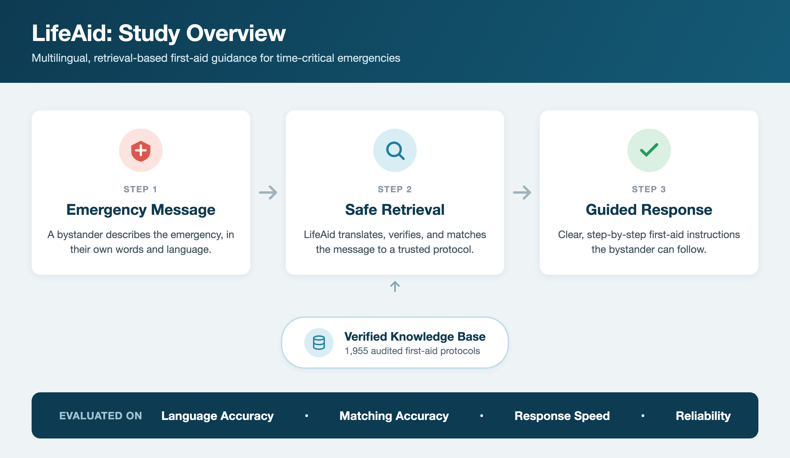

# LifeAid: A Multilingual, Retrieval-Based Conversational Agent for Pre-Hospital First Aid Guidance

This repository accompanies the LifeAid study. It contains the manuscript, its figures, a technical description of the method, and the reported evaluation results as machine-readable tables.

> **Source code is not included in this repository.** See [Code and data availability](#code-and-data-availability).



## Summary

LifeAid is a low-latency conversational agent that delivers step-by-step first-aid instructions in more than 15 languages. User queries are mapped to a fixed knowledge base of 1,955 structured emergency scenarios. Responses are retrieved, not generated, so the system cannot hallucinate medical content.

The retrieval pipeline combines:

- spell correction using a medical-term whitelist
- vague-query detection
- hybrid language detection (signature-word lookup for Latin scripts, statistical classification for other scripts) with bidirectional translation
- canonical query expansion (exact, fuzzy ≥ 80% and word-overlap matching)
- dual-path TF-IDF and cosine-similarity scoring (full query and stop-word-stripped query)
- a 2× score boost for critical terms such as cardiac arrest, choking and overdose
- a 0.15 acceptance threshold, below which the user is asked to clarify

## Key results

The evaluation used 69 test cases in English, Arabic, French and German (full tables in [`results/`](results/)):

| Metric | Value |
|---|---|
| Scenario-matching accuracy | 94.2% (65 / 69) |
| Language-identification accuracy | 100% |
| Mean response latency | 0.357 s |
| Severity-detection rate | 69.6% |
| Operational error rate | 0% |

## Repository contents

```
lifeaid/
├── paper/
│   └── LifeAid_manuscript.pdf        Full manuscript
├── figures/
│   ├── fig1_pipeline.png             Figure 1: Proposed pipeline / study overview
│   ├── fig2_system_architecture.png  Figure 2: System architecture
│   └── fig3_web_interface.png        Figure 3: LifeAid web interface
├── docs/
│   ├── methods.md                    Architecture, knowledge base and NLP pipeline (with equations and parameters)
│   └── evaluation.md                 Evaluation protocol, metrics and limitations
├── results/
│   ├── table1_quantitative_results.csv
│   ├── table2_functional_tests.csv
│   └── table3_system_comparison.csv
├── CITATION.cff
└── LICENSE
```

## Code and data availability

The LifeAid application (Python 3.11 / Streamlit) and its knowledge base are not published in this repository. [`docs/methods.md`](docs/methods.md) documents the pipeline, its parameters and the knowledge-base schema in enough detail to reimplement the approach. For questions about the software or data, contact the corresponding author.

## Disclaimer

LifeAid is a research prototype. It has not been clinically validated or evaluated with clinicians in the loop. Its severity labels (Critical, Urgent, Moderate) and first-aid guidance are not clinical diagnoses or treatment recommendations. In an emergency, always contact your local emergency services.

## Citation

If you use this work, please cite it as described in [`CITATION.cff`](CITATION.cff):

> Salaheldin, A., Medhat, B., Saad, R. and Saleh, N. (2026) LifeAid: A Multilingual, Retrieval-Based Conversational Agent for Pre-Hospital First Aid Guidance.

## Authors

- **Ahmed Salaheldin**\* and **Bassem Medhat**: Artificial Intelligence Programme, School of Engineering and Computer Science, University of Hertfordshire, hosted by GAF, New Capital, Egypt
- **Rahma Saad** and **Neven Saleh**: Biomedical Engineering Department, Faculty of Engineering and Technology, Future University in Egypt, Cairo, Egypt

\*Corresponding author: a.salah@gaf.edu.eg

## License

The manuscript, figures, documentation and result tables are released under the [Creative Commons Attribution 4.0 International License](LICENSE) (CC BY 4.0).
