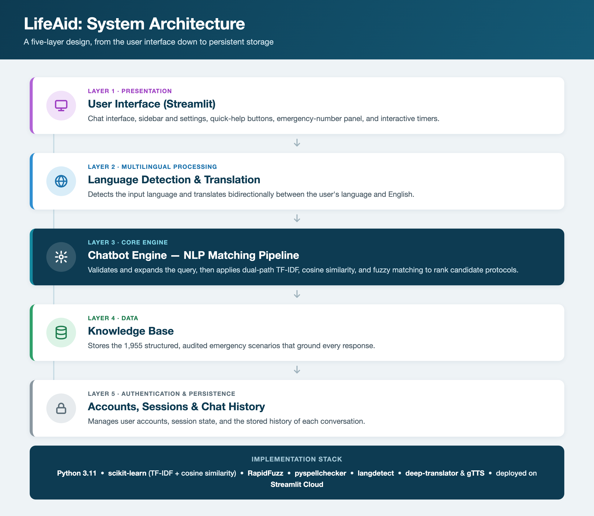

# Methods

This document describes the LifeAid system as reported in Section 3 of the [manuscript](../paper/LifeAid_manuscript.pdf).

## 1. Development methodology

LifeAid was built iteratively. Each phase ended with a working version that was reviewed and refined before the next phase began. This approach was chosen because the best configuration of the NLP matching component could not be fixed in advance. The matching strategy was tuned through repeated experiments on real interaction data (Figure 1).

## 2. System architecture

The system has five layers:

| Layer | Responsibility |
|---|---|
| Presentation | Streamlit chat interface, sidebar, settings, quick-help buttons, emergency-number panel, interactive timers |
| Multilingual processing | Language detection; translation between the user's language and English |
| Chatbot engine | Runs the NLP matching pipeline |
| Knowledge base | Stores the structured emergency scenarios |
| Authentication and persistence | User accounts, session state, chat history |

### Technology stack

| Purpose | Library / service |
|---|---|
| Language runtime | Python 3.11 |
| Web framework | Streamlit (deployed on Streamlit Cloud) |
| TF-IDF vectorisation, cosine similarity | scikit-learn |
| Fuzzy string matching | RapidFuzz |
| Spell correction | pyspellchecker |
| Language identification | langdetect + signature-word lookup |
| Translation | deep-translator (Google Translate) |
| Text-to-speech | gTTS |
| Version control | GitHub |

## 3. Knowledge base

Each scenario entry has five fields:

| Field | Description |
|---|---|
| `question` | Representative question used as the matching target |
| `answer` | Step-by-step first-aid response |
| `severity` | `Critical`, `Urgent` or `Moderate` |
| `keywords` | Domain keywords used to enrich TF-IDF matching (at least 5 per scenario) |
| `follow_ups` | Follow-up questions and answers for diagnostic branching |

The knowledge base was built in two stages:

1. **Core authoring.** 345 core emergency scenarios were written by hand, based on guidance from the Red Cross, the WHO and the American Heart Association.
2. **Expansion and audit.** Sub-scenarios, phrasing variants and more emergency classes brought the total to **1,955 scenarios**. A manual keyword audit then removed **610 cross-domain keywords** that could make unrelated scenarios match each other. The audit also confirmed that every scenario kept at least five domain-relevant keywords.

## 4. NLP matching pipeline

The pipeline has eight sequential steps:

| # | Step | Details |
|---|---|---|
| 1 | Spell correction | Medical-term whitelist plus custom correction overrides for common first-aid terms |
| 2 | Vague-input detection | Very short or generic inputs (e.g. "help", "pain") trigger a clarification prompt |
| 3 | Language detection and translation | Latin-script input: signature-word lookup. Non-Latin script: statistical classifier. Non-English input is translated into English |
| 4 | Query expansion | Appends canonical emergency terms using exact, fuzzy (≥ 80% similarity, Eq. 4) and word-overlap matching against a lookup of known phrasings |
| 5 | Dual-path TF-IDF scoring | Cosine similarity against the knowledge base, computed for the full query (path A) and a stop-word-stripped query (path B). Unigram + bigram features, at most 8,000 terms (Eqs. 1–3) |
| 6 | Priority keyword boosting | 2× score multiplier for matches with critical terms (e.g. cardiac arrest, choking, overdose) (Eq. 5) |
| 7 | Threshold scoring | The top-ranked scenario is accepted only if its score is ≥ 0.15. Otherwise the user is asked to clarify (Eq. 6) |
| 8 | Response localisation | The response is translated back into the detected language; Arabic is rendered right to left |

### Scoring equations

For a query *q* and knowledge-base entry *d*:

**(1) TF-IDF weight of term *t***

$$w_{t,d} = tf_{t,d} \times \log\left(\frac{N}{df_t}\right)$$

**(2) Cosine similarity for path *p* ∈ {A, B}**

$$sim_p(q, d) = \frac{q_p \cdot d_p}{\lVert q_p \rVert \, \lVert d_p \rVert}$$

**(3) Dual-path combination**

$$S(q, d) = \max\big(sim_A(q, d),\ sim_B(q, d)\big)$$

**(4) Fuzzy similarity for query expansion (accepted at ≥ 80%)**

$$Sim_{fuzzy}(a, b) = \left(1 - \frac{Lev(a, b)}{\max(|a|, |b|)}\right) \times 100\%$$

**(5) Priority keyword boosting**

$$S'(q, d) = S(q, d) \times B(d), \qquad B(d) = \begin{cases} 2 & \text{if } d \text{ contains a critical term} \\ 1 & \text{otherwise} \end{cases}$$

**(6) Match decision**

$$Match(q) = \begin{cases} \arg\max_d S'(q, d) & \text{if } S'(q, d) \ge 0.15 \\ \text{clarification prompt} & \text{otherwise} \end{cases}$$

### Parameter summary

| Parameter | Value |
|---|---|
| TF-IDF n-gram range | (1, 2) |
| Maximum TF-IDF features | 8,000 |
| Fuzzy expansion threshold | 80% |
| Priority boost factor | 2× |
| Match acceptance threshold | 0.15 |
| Knowledge-base size | 1,955 scenarios |
| Minimum keywords per scenario | 5 |

## 5. Interactive features

- Quick-help buttons for bleeding, choking, CPR and burns
- Countdown timers, including a 2-minute CPR timer and a 20-minute burn-cooling timer, with start, pause and reset controls
- Text-to-speech output (tested in English and Arabic)
- Right-to-left rendering for Arabic
- Emergency-number panel for eight supported regions
- User registration and login, plus chat history that is saved and reloaded
- Dark and light themes
